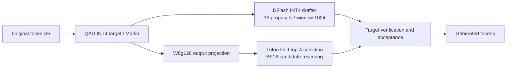

# Efficient Qwen — Final

One final inference configuration for **Qwen3.5-4B on NVIDIA A10G 24 GB**:

**QAD INT4 + DFlash K15 + W8g128/Triton top-4 output-head rescoring + 1,024-token drafter window. Prefix caching is OFF.**

The final setting passed all three full quality thresholds and achieved a **5.092x arithmetic mean speedup against BF16 on the same vLLM 0.22.1 engine**, on the local synthetic latency workload below. This is a local measurement, not an official competition result or a universal speed guarantee.

## Final results

| AVG SPEEDUP | SHORT (64T) | MEDIUM (2048T) | LONG (8192T) | MMLU-PRO ≥62.1% | IFEVAL ≥81.4% | GPQA-DIAMOND ≥63.0% |
|--:|--:|--:|--:|--:|--:|--:|
| **5.092x** | 264 ms | 1,530 ms | 2,862 ms | ✅ 0.661 | ✅ 0.819 | ✅ 0.636 |

Speedup is the arithmetic mean against same-engine BF16; latencies are medians. Token counts in the headers are input lengths. Latencies are rounded to whole milliseconds and quality scores to three decimal places; pass indicators use the unrounded scores.

<details>
<summary>Detailed measurements and evaluation conditions</summary>

| Workload | Input → output | Median ms | p95 ms | Output tokens/s | BF16 (vLLM 0.22.1) speedup | Initial BF16 (vLLM 0.19.0) speedup |
|:--|--:|--:|--:|--:|--:|--:|
| Short | 64 → 128 | 264.39 | 321.23 | 478.70 | 9.586× | 9.806× |
| Medium | 2,048 → 256 | 1,530.14 | 1,820.12 | 181.73 | 3.471× | 3.541× |
| Long | 8,192 → 256 | 2,861.74 | 3,279.75 | 94.93 | 2.219× | 2.258× |
| Mean of speedups | | | | | **5.092×** | **5.202×** |

The initial BF16 reference used vLLM 0.19.0. The ratio of mean latencies against that reference is 3.108×, a different statistic. Maximum sampled whole-GPU memory was 20,739 MiB for latency and 20,745 MiB for quality. These are sampled observations, not allocator peaks.

| Full evaluation | Documents | Score | Threshold | Generation |
|:--|--:|--:|--:|:--|
| MMLU-Pro, 5-shot | 12,032 | 0.6610 | ≥ 0.621 | Thinking OFF, max 2,048 |
| IFEval, 0-shot | 541 | 0.8189 | ≥ 0.814 | Thinking OFF, max 512 |
| GPQA-Diamond, 0-shot | 198 | 0.6364 | ≥ 0.630 | Thinking ON + streaming, max 12,288 |

Quality concurrency was 8; all documents were evaluated. MMLU-Pro is macro-averaged across subjects. IFEval uses strict instruction-level accuracy (683/834 instructions). No speed-only forced output length was used for quality.

</details>

## Architecture



The tied BF16 input embedding stays unchanged. The additional output head is approximate: only four scores are recomputed from the original BF16 weights, while other logits remain approximate. The window reduces drafter attention reads; full KV allocation is retained.

## Files

- `run_final.py`: prints or starts this single final serving configuration.
- `recorded-final.json`: measured Docker/client commands, engine versions and runtime checks.
- `runtime_plugin/` and `kernels/head_rerank.py`: byte-identical measured runtime source. The helper's optional Marlin tile dispatcher remains inactive; no alternative tile configuration is shipped.
- `results/output-head-fusion022-micro/`: the one selected head configuration and its numerical/timing evidence. Internal control rows are retained because the frozen loader validates their hashes.
- `evidence/final-results.json` / `.csv`: final setting only, with shared and unshared workloads separated.
- `evidence/latency-*.jsonl`: per-request timings, actual token counts, warmups and failures; response payloads removed.
- `evidence/full-quality-audit.json`: summary of the full private quality audit. Benchmark questions and raw answers are not redistributed.

## Model files

Use the exact revisions and file hashes in [models.json](models.json):

| Local directory | Model | Revision |
|:--|:--|:--|
| `qwen-qad` | [QAD INT4 target](https://huggingface.co/nota-ai/Qwen3.5-4B-QAD-W4A16) | `a67b0fedb2b39cb057da6114e656b76b52d321b4` |
| `qwen-dflash-qad` | [DFlash drafter](https://huggingface.co/nota-ai/Qwen3.5-4B-DFlash-GPTQ-W4A16) | `c5fb290e47e30c81d06e48b0495ec06f2560dd4e` |
| `qwen-weights` | [Original tokenizer/configuration](https://huggingface.co/Qwen/Qwen3.5-4B) | `851bf6e806efd8d0a36b00ddf55e13ccb7b8cd0a` |

The final deployment needs the QAD target, DFlash drafter and original tokenizer files. Original BF16 model weights are not required for final serving. Download pinned revisions from Hugging Face, or restore the private Drive model backup. There is no separately trained merged final checkpoint: the extra head buffers are prepared from the target checkpoint at runtime.

## Run the frozen configuration

```bash
# CPU-only: check frozen source/evidence hashes and print the recorded Docker command.
python3 run_final.py --model-root /path/to/models

# Before --start, supply the actual current rental ledger in results/budget.json.
python3 budget.py --check
python3 run_final.py --model-root /path/to/models --start
```

The model root contains the three directory names above. `--start` validates source, checkpoint and tokenizer hashes, checks the rental budget, and starts the measured image on loopback port 8080. It does not overwrite an existing container named `efficient-qwen-final`.

The frozen local Docker image ID is recorded in `recorded-final.json`. On the original experiment server it can be used directly. `docker/Dockerfile.dflash` and [REPRODUCING.md](REPRODUCING.md) describe rebuilding the pinned upstream plugin image. A rebuilt image may have a different local identity and needs new kernel/runtime validation and full evaluation before claiming the recorded result. This publication did not rerun GPU experiments or validate a new image.

## Measurement limits

Latency used raw text over same-host `/v1/completions`, no chat template, temperature 0, concurrency 1, 5 warmups + 50 measured requests per scenario. Prompts contain a nonce and repetitive synthetic filler; they may favor speculative decoding. Output lengths were forced identically for both models in speed tests only. All final timing rows had zero request failures. Profiling was separate from final timing.

Shared-prefix results are separate and do not enter the headline speedup. The final setting is not fastest on every workload: the external optimized reference of 389/941/2,403 ms is faster on Medium and Long. Only this final deployment configuration is included in this repository; full research history and report PDFs remain in the project backup.

QAD, DFlash, the drafter window implementation, vLLM and Marlin are upstream work. This project's additional implementation is the output-head path and its validation/integration. See [THIRD_PARTY_NOTICES.md](THIRD_PARTY_NOTICES.md).
